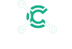
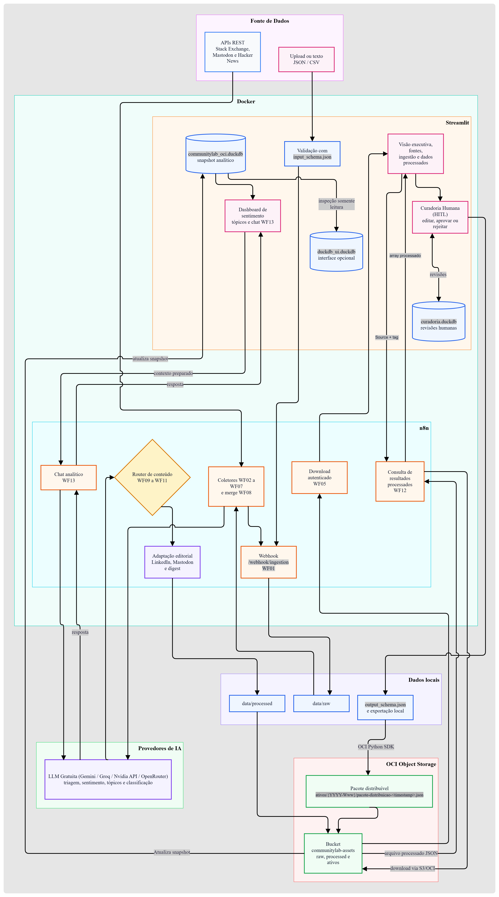

<p align="center">
  
</p>

<div align=center>
  <h3> Community LED Marketing Engine </h3>
</div>

<p align="left">
  
  
  
  
  
  
  
</p>

<p align="left">

  
  
  

</p>

---

## Descrição

O **CommunityLab** é um ecossistema inteligente de automação projetado para transformar o fluxo contínuo de discussões e dúvidas de comunidades técnicas em ativos estruturados de valor educacional e marketing.

Projeto desenvolvido pelo **Grupo 14 - Turma G10** para o Hackathon ONE - G10 Brasil, do programa **ONE - Oracle Next Education**.

---

## Sumário

* [1. Problema](#1-problema)
* [2. Objetivo](#2-objetivo)
* [3. Tecnologias](#3-tecnologias)
* [4. Entregáveis](#4-entregáveis)
* [5. Fases do Projeto](#5-fases-do-projeto)
* [6. Demo](#6-arquitetura-da-solução)
* [7. Arquitetura da Solução](#7-arquitetura-da-solução)
* [8. Estrutura de Diretórios](#8-estrutura-de-diretórios)
* [9. Como Executar](#9-como-executar)
* [10. Limitações e Próximos Passos](#10-limitações-e-próximos-passos)
* [11. Documentação](#11-documentação)
* [12. Equipe](#12-equipe)

---

## 1. Problema

Equipes que acompanham comunidades técnicas lidam com canais dispersos, como Discord, Slack e fóruns online, onde depoimentos valiosos ficam perdidos em meio ao volume de dados diários. A isso se soma as dezenas de horas gastas para se realizar a triagem de forma manual e a baixa conversão, já que propagandas corporativas geram menos confiança do que recomendações de pares. 

---

## 2. Objetivo

Desenvolvimento de um MVP funcional capaz de resolver esse gargalo, capaz de unificar a ingestão de dados de comunidades, orquestrar triagens com IA, permitir curadoria humana (*Human-in-the-Loop*) e persistir pacotes de conteúdo estruturados na nuvem OCI. 

---

## 3. Tecnologias

* **Linguagem:** Python 3.11+
* **Interface / Curadoria:** Streamlit
* **Engenharia de Dados:** DuckDB, Pandas, JSON Schema
* **Orquestração:** n8n (Docker)
* **Modelos de IA Gratuitos:** Google Gemini API (Camada Gratuita) / Groq / Nvidia API / OpenRouter
* **Cloud & Armazenamento:** Oracle Cloud Infrastructure (OCI Object Storage Always Free)
* **Versionamento:** Git e GitHub

---

## 4. Entregáveis

Abaixo, encontram-se os principais produtos e artefatos desenvolvidos pelo projeto:

| Entregável | Formato / Plataforma | Descrição | Link de Acesso |
| :--- | :--- | :--- | :--- |
| **Interface Streamlit** | Streamlit / Python | Painel para ingestão, análise de sentimentos, chat analítico e curadoria humana | [🖥️ Ver Interface](./src/main.py) |
| **Workflows de Automação** | n8n / JSON | Coleção de workflows para ingestão, coleta, triagem, adaptação, consulta e análise de resultados | [🔄 Ver Workflows](./n8n/workflows/) |
| **Contratos de Dados** | JSON Schema | Schemas formais usados para validar os dados de entrada e os pacotes de saída | [📋 Ver Contratos](./data/schemas/) |
| **Banco Analítico** | DuckDB | Snapshot consolidado em `communitylab_oci.duckdb` e banco de revisões em `curadoria.duckdb` | [🗃️ Ver Scripts DuckDB](./src/scripts/) |
| **Armazenamento Cloud** | OCI Object Storage | Persistência de dados brutos, resultados processados e pacotes aprovados no bucket OCI | [☁️ Ver Integração OCI](./src/services/oci_storage.py) |
| **Documentação Técnica** | Markdown / Mermaid / PNG | Especificações da arquitetura, integrações, ADRs e documentação dos componentes | [📚 Ver Documentação](./docs/specs/) |
| **Testes Automatizados** | Pytest / Python | Suíte de testes para ingestão, validação, OCI, Streamlit, Router e Adapters | [✅ Ver Testes](./tests/) |

---

## 5. Fases do Projeto

Desenvolvimento iterativo gerenciado via quadro Kanban no GitHub Projects pela equipe ao longo de 6 semanas:

<p align="left">
  <a href="https://github.com/orgs/No-Country-simulation/projects/565/views/1">
        
  </a>
</p>

| Período | Foco | Principais Entregas |
| :--- | :---: | :--- |
| Semana 00 | Alinhamento Estratégico, Documentação Inicial e Configurações base | Escopo e infraestrutura base |
| Semana 01 | Engenharia de Prompts, Datasets & Ingestão | Schemas, contrato de dados e webhooks de ingestão de dados |
| Semana 02 | Orquestração Condicional n8n & Módulos da Interface | Webhooks de triagem e roteamento, desenvolvimento das interfaces de entrada e conexão com OCI |
| Semana 03 | Geração Consolidada, Persistência e Curadoria | Interface de curadoria humana, integração n8n/streamlit/OCI e dashboard de sentimentos e tópicos  |
| Semana 04 | Homologação e Revisão | Dicionário de dados, arquitetura do pipeline, homologação dos 3 cenários, revisão de código |
| Semana 05 | Documentação, Apresentação e Revisão Final | Revisão da documentação, atualização do README, elaboração de slides e vídeo, e code freeze |
| Semana 06 | Demo Day | Ensaios e apresentação do projeto |

---

## 6. Demo

<p align="center">
  <picture>
    
  </picture>
  <br>
  <em>Fig. 01 - Arquitetura do pipeline multicanal</em>
</p>

---

## 7. Arquitetura da Solução

<p align="center">
  <picture>
    <source srcset="./docs/assets/pipeline-architecture-v2.gif" type="image/gif">
    
  </picture>
  <br>
  <em>Fig. 02 - Arquitetura do pipeline multicanal</em>
</p>

| Camada | Tecnologia / Ferramenta | Responsabilidade Técnica | Justificativa Arquitetural |
| --- | --- | --- | --- |
| **Entradas** | APIs REST, JSON e CSV | Coleta dados das APIs de Stack Exchange, Mastodon e Hacker News e aceita conteúdo manual pela interface. | Normaliza múltiplas fontes sem acoplar a interface aos provedores externos. |
| **Orquestração** | **n8n** (Docker Compose) | Executa coletores, merges, triagem, roteamento, adaptação editorial, consulta de resultados processados no WF12 e chat analítico no WF13. | Orquestração visual self-hosted, versionada como workflows JSON em `n8n/workflows/`. |
| **Interface e Curadoria** | **Streamlit** + Python 3.11 | Exibe dashboards, processa ingestão, registra revisões HITL e exporta JSON aprovado. | Permite operação interna sem desenvolver uma aplicação web separada. |
| **Engenharia de Dados** | **DuckDB** + JSON Schema | Mantém `communitylab_oci.duckdb` como snapshot analítico consolidado, `curadoria.duckdb` como estado das revisões humanas e `duckdb_ui.duckdb` como banco auxiliar opcional da DuckDB UI. | Processamento local rápido e separação entre dados analíticos, interface auxiliar e estado da curadoria. |
| **Motor de LLM** | **Gemini / Groq / NVIDIA / OpenRouter** | Os modelos participam da triagem, classificação e análise de sentimentos. | Provedores separados por finalidade permitem gerar classificações editoriais e respostas analíticas sem acoplamento direto ao OCI. |
| **Persistência** | **OCI Object Storage** | Guarda dados brutos, processados e pacotes aprovados em pastas estruturadas. | Mantém os artefatos disponíveis para n8n e Streamlit dentro da cota OCI Always Free. |

---

## 8. Estrutura de Diretórios

```
├── 📁 .github/                                # Governança do GitHub
│   ├── 📁 ISSUE_TEMPLATE/                     # Template para criação de issues
│   └── 📄 PULL_REQUEST_TEMPLATE.md            # Template para criação de PR
│
├── 📁 .setup/                                 # Arquivos de setup e build
│   └── 📁 docker/
│       └── 📁 streamlit/                      # Build da aplicação Streamlit
│           ├── 📄 Dockerfile                  # Imagem Docker da aplicação
│           └── 📄 config.toml                 # Configuração do Streamlit (watchdog e recarga ao salvar)
│
├── 📁 data/                                   # Estrutura e contratos de dados
│   ├── 📁 fixtures/                           # Dados sintéticos criados para teste 
│   ├── 📁 processed/                          # Dados JSON processados (conteúdo ignorado via .gitignore)
│   ├── 📁 prompts/                            # Repositório de artefatos de prompt
│   ├── 📁 raw/                                # Dados brutos (conteúdo ignorado via .gitignore)
│   ├── 📁 samples/                            # Exemplos de teste
│   └── 📁 schemas/                            # Contratos JSON Schema obrigatórios
│
├── 📁 docs/                                   # Documentação técnica e governança
│   ├── 📁 adr/                                # Registro de decisões arquiteturais
│   ├── 📁 benchmarks/                         # Resultados de testes executados
│   ├── 📁 assets/                             # Imagens, fluxogramas e diagramas da documentação
│   ├── 📁 meetings/                           # Atas das reuniões e rituais ágeis
|   ├── 📁 notes/                              # Notas gerais e guias de contribuição
│   ├── 📁 specs/                              # Especificações funcionais e técnicas (SDDs)
│   └── 📄 escopo_projeto.md                   # Especificação do escopo e requisitos
│
├── 📁 n8n/                                    # Orquestração e workflows locais
│   └── 📁 workflows/                          # Fluxos do n8n exportados em JSON
│
├── 📁 references/                             # Materiais externos de consulta do projeto
│
├── 📁 src/                                    # Código-fonte da aplicação
│   ├── 📁 infra/                              # Scripts de provisionamento do OCI Object Storage
│   ├── 📁 pipeline/                           # Orquestração do fluxo de dados
│   ├── 📁 scripts/                            # Scripts de execução DuckDB
│   ├── 📁 services/                           # Integrações com serviços externos
│   ├── 📁 utils/                              # Funções utilitárias e helpers
│   ├── 📁 validation/                         # Validação contratual dos schemas
│   ├── 📁 views/                              # Telas e interfaces modulares do Streamlit
│   ├── 📄 config.py                           # Configurações globais da aplicação
│   ├── 📄 design.py                           # Sistema visual e estilos da interface
│   ├── 📄 ui.py                               # Componentes e configuração da interface
│   ├── 📄 ui_localization.py                  # Localização de componentes nativos do Streamlit
│   └── 📄 main.py                             # Ponto de entrada: uv run python -m streamlit run src/main.py
│
├── 📁 tests/                                  # Testes automatizados
│
├── 📄 .dockerignore                           # Arquivos excluídos do contexto de build da imagem Docker
├── 📄 .editorconfig                           # Padronização de estilo de formatação entre diferentes editores e IDEs
├── 📄 .env.example                            # Modelo de exemplo de variáveis de ambiente
├── 📄 .gitignore                              # Regras de arquivos e diretórios ignorados pelo Git
├── 📄 docker-compose.yml                      # Serviços Docker: n8n self-hosted e aplicação Streamlit
├── 📄 LICENSE                                 # Termos de licença de uso do software
├── 📄 pyproject.toml                          # Metadados, dependências e configurações do uv/Python
├── 📄 README.md                               # Apresentação do projeto e instruções de execução
├── 📄 requirements.txt                        # Lista de dependências e bibliotecas do projeto
└── 📄 uv.lock                                 # Travamento das versões exatas das dependências do projeto

```

---

## 9. Como Executar

### Pré-requisitos

- [Python 3.11+](https://www.python.org/)
- [Git](https://git-scm.com/)
- [uv](https://docs.astral.sh/uv/)
- [Docker](https://docs.docker.com/get-docker/) e Docker Compose instalados e em execução.

---

### Passo a Passo

Execute o passo a passo a seguir no terminal:

#### 1. Clonar o repositório e acessar a branch `develop`

```bash
git clone <URL_DO_REPOSITORIO>
cd G10-BRASIL-Equipe-14
git checkout develop

```

#### 2. Instalar dependências e sincronizar o ambiente Python

Com o uv instalado, execute na raiz do projeto:

```bash
uv sync

```

O comando acima cria o ambiente virtual `.venv` e instala todas as dependências travadas no `uv.lock`.

#### 3. Configurar as Variáveis de Ambiente

Crie uma cópia do arquivo de exemplo `.env.example` para gerar o seu `.env` local:

```bash
# Linux/macOS
cp .env.example .env
```

No Windows PowerShell:

```powershell
Copy-Item .env.example .env
```

> Configure as chaves de API e credenciais necessárias dentro do arquivo `.env` gerado. Antes de iniciar os containers Docker, defina `N8N_BASE_URL=http://n8n:5678` para permitir que o Streamlit comunique-se com o n8n pela rede interna do Docker Compose.

#### 4. Iniciar os serviços com Docker

Suba os containers em segundo plano (*detached mode*):

```bash
docker compose up -d

```

#### 5. Verificar o status da aplicação

Confirme se os containers estão com status **Up** e acessíveis nas portas configuradas:

```bash
docker compose ps

```

*(Opcional) Acompanhar os logs em tempo real:*

```bash
docker compose logs -f n8n

```

#### 6. Acessar a interface web do n8n

* Abra o navegador em: [http://localhost:5678](http://localhost:5678)
* Crie a sua conta de proprietário local (apenas no primeiro acesso).

> [!TIP]
Todos os fluxos, credenciais e configurações criados no n8n ficam salvos no volume local mapeado (`./n8n/n8n_data`), garantindo que nenhum progresso seja perdido ao reiniciar os containers. Essa pasta é criada pelo Docker e ignorada pelo Git.

#### 7. Parar os serviços

Quando terminar o desenvolvimento, você pode pausar ou desligar os containers:

```bash
# Para pausar a execução mantendo o estado
docker compose stop
```

```bash
# Para encerrar os containers e liberar a rede
docker compose down

```

#### 8. Rodar os testes automatizados

Com as dependências sincronizadas (passo 2), execute a suíte de testes com:

```bash
uv run pytest

```

Para rodar um teste específico:

```bash
uv run pytest tests/test_schema_validator.py::test_validate_data_returns_no_errors_for_valid_record

```

#### 9. Validar um JSON externo contra o contrato de entrada

O script `src/validation/schema_validator.py` valida um arquivo JSON contra um JSON Schema informado explicitamente. Para validar contra o contrato de entrada:

```bash
uv run python -m src.validation.schema_validator <caminho/para/dados.json> data/schemas/input_schema.json

```

O comando retorna `Valid` (exit code `0`) se o arquivo estiver em conformidade, ou `Invalid` (exit code `1`) listando cada erro encontrado, caso contrário.

#### 10. Rodar a aplicação Streamlit

Com as dependências sincronizadas (passo 2), inicie o painel na raiz do projeto:

```bash
uv run python -m streamlit run src/main.py

```

* Abra o navegador em: [http://localhost:8501](http://localhost:8501)
* Use `python -m streamlit` (e não só `streamlit`) para que a raiz do projeto entre no `sys.path` e os imports `src.*` funcionem.
* O arquivo `.setup/docker/streamlit/config.toml` (copiado para `.streamlit/config.toml` na imagem Docker) ativa o `watchdog` e o `runOnSave`.
* Para encerrar, pressione `Ctrl+C` no terminal.

#### 11. Rodar a aplicação Streamlit com Docker (alternativa)

Não é necessário ter Python ou uv instalados para este caminho. O serviço `streamlit` do `docker-compose.yml` é construído a partir do `.setup/docker/streamlit/Dockerfile` e usa o mesmo `.env` (passo 3).

```bash
# Construir a imagem e subir apenas o painel
docker compose up -d --build streamlit
```

```bash
# Ou subir todos os serviços (n8n + Streamlit)
docker compose up -d --build

```

* Abra o navegador em: [http://localhost:8501](http://localhost:8501)
* Acompanhar os logs: `docker compose logs -f streamlit`
* Parar o painel: `docker compose stop streamlit` (ou `docker compose down` para encerrar todos os serviços)
* A porta pode ser alterada com `STREAMLIT_PORT` no `.env`.
* A pasta `./data` é montada em `/code/data` dentro do container.

> [!NOTE]
> O código é copiado para dentro da imagem, então alterações em `src/` exigem reconstruir com `docker compose up -d --build streamlit`. Para desenvolvimento com recarga automática, prefira o passo 10.

---

## 10. Limitações e Próximos Passos

* **Publicação multicanal:** A curadoria gera e valida conteúdos para LinkedIn, Mastodon, FAQ e newsletters, mas a publicação direta nas redes permanece fora do MVP e requer a integração das APIs oficiais de cada canal.

* **Implantação em nuvem:** A solução é executada localmente com Docker Compose e utiliza OCI Object Storage para persistência; como próximo passo, o ambiente pode ser implantado em OCI Compute com configuração de domínio, HTTPS e monitoramento.

* **Resiliência e evolução operacional:** Ampliar o monitoramento das execuções do n8n, a cobertura de testes dos workflows, as políticas de retry e fallback dos provedores de IA e a observabilidade dos snapshots DuckDB.

---

## 11. Documentação

### Arquitetura e Escopo
- [Escopo do Projeto](docs/escopo-projeto.md)
- [Especificação de Arquitetura](docs/specs/arquitetura-projeto.md)
- [Registro de Decisões Arquiteturais (ADR)](docs/adr/)

### Integrações e Componentes
- [Integração Streamlit e n8n](docs/specs/conexao-streamlit-n8n.md)
- [Integração com OCI Object Storage](docs/specs/oci-object-storage-n8n.md)
- [Arquitetura do Router](docs/specs/arquitetura-router.md)
- [Arquitetura dos Adapters](docs/specs/arquitetura-adapters.md)
- [Especificações das APIs](docs/specs/)

### Governança e Evidências
- [Atas de Reunião](docs/meetings/)
- [Resultados dos Benchmarks](docs/benchmarks/)
- [Padrões do GitHub Projects](docs/notes/github-projects-guide.md)
- [Guia de Rebase](docs/notes/git-rebase-guide.md)

---

## 12. Equipe

<div align="center">

| | | |
|:---:|:---:|:---:|
| <br>[Gustavo Silva](https://github.com/Gustavotuur) | <br>[Michael Dambock](https://github.com/dammi01) | <br>[Ricieri Rosa](https://github.com/garcezrosa) |
| <br>[Rodrigo Aguiar](https://github.com/RAguiarEng) | <br>[Vitor Pires](https://github.com/vikpires) | |

</div>