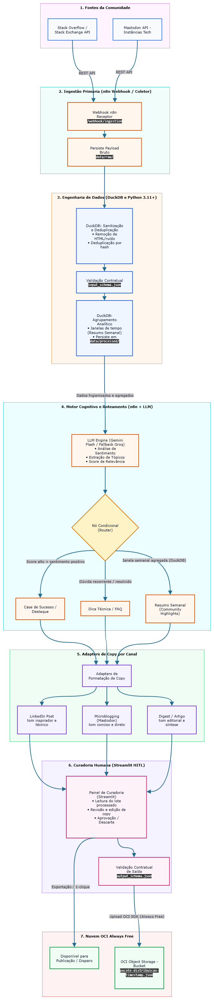

<p align="center">
  
</p>

---

# 🚀 CommunityLab – Motor Inteligente de Transformação e Distribuição para Comunidades Digitais

---

## Descrição
O **CommunityLab** é um ecossistema inteligente de automação projetado para transformar o fluxo contínuo de discussões e dúvidas de comunidades técnicas em ativos estruturados de valor educacional e marketing.

Projeto desenvolvido pelo **Grupo 14 - Turma G10** para o Hackathon ONE - G10 Brasil, do programa **ONE - Oracle Next Education**.

---

## Sumário

* [1. Objetivo](#1-objetivo)
* [2. Tecnologias](#2-tecnologias)
* [3. Arquitetura](#3-arquitetura)
* [4. Estrutura de Diretórios](#4-estrutura-de-diretórios)
* [5. Como Executar](#5-como-executar)
* [6. Fluxo Git e Contribuição](#6-fluxo-git-e-contribuição)
* [7. Cronograma Geral](#7-cronograma-geral)
* [8. Equipe](#8-equipe)

---

## 1. Objetivo

Desenvolver um MVP funcional capaz de ingerir dados de comunidades, orquestrar triagens com IA, permitir curadoria humana (*Human-in-the-Loop*) e persistir pacotes de conteúdo estruturados na nuvem OCI.

---

## 2. Tecnologias

* **Linguagem:** Python 3.11+
* **Interface / Curadoria:** Streamlit
* **Engenharia de Dados:** DuckDB, Pandas, JSON Schema
* **Orquestração:** n8n (Docker)
* **Modelos de IA:** Google Gemini API (Camada Gratuita) / Groq ou Ollama
* **Cloud & Armazenamento:** Oracle Cloud Infrastructure (OCI Object Storage Always Free)

---

## 3. Arquitetura

<p align="center">
  
  <br>
  <em>Fig.01 - Arquitetura conceitual do pipeline multicanal</em>
</p>

---

## 4. Estrutura de Diretórios

```
├── 📁 .github/                                # Governança do GitHub
│   └── 📄 PULL_REQUEST_TEMPLATE.md            # Template para criação de PR
│
├── 📁 .setup/                                 # Arquivos de setup e build
│   └── 📁 docker/
│       └── 📁 streamlit/                      # Build da aplicação Streamlit
│           ├── 📄 Dockerfile                  # Imagem Docker da aplicação
│           └── 📄 config.toml                 # Configuração do Streamlit (watchdog e recarga ao salvar)
│
├── 📁 app/                                    # Aplicação Streamlit (painel de curadoria)
│   └── 📄 main.py                             # Ponto de entrada: uv run streamlit run src/app/main.py
│
├── 📁 data/                                   # Estrutura e contratos de dados
│   ├── 📁 raw/                                # Dados brutos baixados (conteúdo ignorado via .gitignore)
│   ├── 📁 processed/                          # Dados pós-processamento/DuckDB (conteúdo ignorado via .gitignore)
│   ├── 📁 schemas/                            # Contratos JSON Schema obrigatórios
│   └── 📁 samples/                            # Exemplos de teste
│
├── 📁 docs/                                   # Documentação técnica e governança
│   ├── 📁 adr/                                # Registro de decisões arquiteturais
│   ├── 📁 assets/                             # Imagens, fluxogramas e diagramas da documentação
│   ├── 📁 meetings/                           # Atas das reuniões e rituais ágeis
│   ├── 📁 specs/                              # Especificações funcionais e técnicas (SDDs)
│   ├── 📄 guia_github_projects.md             # Guia de uso do GitHub Projects e padrões de branches, commits e PRs para o time
│   └── 📄 escopo_projeto.md                   # Especificação do escopo e requisitos
│
├── 📁 n8n/                                    # Orquestração e workflows locais
│   └── 📁 workflows/                          # Fluxos exportados em JSON
│
├── 📁 references/                             # Materiais de consulta do projeto
│
├── 📁 src/                                    # Código-fonte da aplicação
│   ├── 📁 pipeline/                           # Ingestão, processamento e validações
│   ├── 📁 services/                           # Integrações com serviços externos
│   ├── 📁 utils/                              # Funções utilitárias e helpers
│   └── 📁 views/                              # Telas e interfaces modulares do Streamlit
│
├── 📁 tests/                                  # Testes automatizados
│
├── 📄 .dockerignore                           # Arquivos excluídos do contexto de build da imagem Docker
├── 📄 .editorconfig                           # Padronização de estilo de formatação entre diferentes editores e IDEs
├── 📄 .env.example                            # Modelo de exemplo de variáveis de ambiente
├── 📄 .gitignore                              # Regras de arquivos e diretórios ignorados pelo Git
├── 📄 docker-compose.yml                      # Serviços Docker: n8n self-hosted e aplicação Streamlit
├── 📄 LICENSE                                 # Termos de licença de uso do software
├── 📄 pyproject.toml                          # Metadados, dependências e configurações do uv/Python
├── 📄 README.md                               # Apresentação do projeto e instruções de execução
├── 📄 requirements.txt                        # Lista de dependências e bibliotecas do projeto
└── 📄 uv.lock                                 # Travamento das versões exatas das dependências do projeto

```

---

## 5. Como Executar

### Pré-requisitos
- [Python 3.11+](https://www.python.org/)
- [Git](https://git-scm.com/)
- [uv](https://docs.astral.sh/uv/)
- [Docker](https://docs.docker.com/get-docker/) e Docker Compose instalados e em execução.

---

### Passo a Passo

Execute o passo a passo a seguir no terminal:

#### 1. Clonar o repositório e acessar a branch `develop`
```bash
git clone <URL_DO_REPOSITORIO>
cd G10-BRASIL-Equipe-14
git checkout develop

```

#### 2. Instalar dependências e sincronizar o ambiente Python
Com o uv instalado, execute na raiz do projeto:

```bash
uv sync

```

O comando acima cria o ambiente virtual `.venv` e instala todas as dependências travadas no `uv.lock`.

#### 3. Configurar as Variáveis de Ambiente

Crie uma cópia do arquivo de exemplo `.env.example` para gerar o seu `.env` local:

```bash
cp .env.example .env

```

> Configure as chaves de API e credenciais necessárias dentro do arquivo `.env` gerado.

#### 4. Iniciar os serviços com Docker

Suba os containers em segundo plano (*detached mode*):

```bash
docker compose up -d

```

#### 5. Verificar o status da aplicação

Confirme se o container está com status **Up** e ouvindo na porta **5678**:

```bash
docker compose ps

```

*(Opcional) Acompanhar os logs em tempo real:*

```bash
docker compose logs -f n8n

```

#### 6. Acessar a interface web do n8n

* Abra o navegador em: [http://localhost:5678](http://localhost:5678)
* Crie a sua conta de proprietário local (apenas no primeiro acesso).

> [!TIP]
> Todos os fluxos, credenciais e configurações criados no n8n ficam salvos no volume local mapeado (`./n8n/n8n_data`), garantindo que nenhum progresso seja perdido ao reiniciar os containers.

#### 7. Parar os serviços

Quando terminar o desenvolvimento, você pode pausar ou desligar os containers:

```bash
# Para pausar a execução mantendo o estado
docker compose stop

# Para encerrar os containers e liberar a rede
docker compose down

```

#### 8. Rodar os testes automatizados

Com as dependências sincronizadas (passo 2), execute a suíte de testes com:

```bash
uv run pytest

```

Para rodar um teste específico:

```bash
uv run pytest tests/test_validator.py::test_validate_returns_no_errors_for_valid_record

```

#### 9. Validar um JSON externo contra o contrato de entrada

O utilitário `src/utils/validator.py` valida qualquer arquivo JSON contra um JSON Schema (por padrão, o contrato de entrada em `data/schemas/input_schema.json`):

```bash
uv run python -m src.utils.validator <caminho/para/dados.json> data/schemas/input_schema.json

```

O comando retorna `Valid` (exit code `0`) se o arquivo estiver em conformidade, ou `Invalid` (exit code `1`) listando cada erro encontrado, caso contrário.

#### 10. Rodar a aplicação Streamlit

Com as dependências sincronizadas (passo 2), inicie o painel na raiz do projeto:

```bash
uv run streamlit run src/app/main.py

```

* Abra o navegador em: [http://localhost:8501](http://localhost:8501)
* O arquivo `.setup/docker/streamlit/config.toml` (copiado para `.streamlit/config.toml` na imagem Docker) ativa o `watchdog` e o `runOnSave`.
* Para encerrar, pressione `Ctrl+C` no terminal.

#### 11. Rodar a aplicação Streamlit com Docker (alternativa)

Não é necessário ter Python ou uv instalados para este caminho. O serviço `streamlit` do `docker-compose.yml` é construído a partir do `.setup/docker/streamlit/Dockerfile` e usa o mesmo `.env` (passo 3).

```bash
# Construir a imagem e subir apenas o painel
docker compose up -d --docker streamlit

# Ou subir todos os serviços (n8n + Streamlit)
docker compose up -d --docker

```

* Abra o navegador em: [http://localhost:8501](http://localhost:8501)
* Acompanhar os logs: `docker compose logs -f streamlit`
* Parar o painel: `docker compose stop streamlit` (ou `docker compose down` para encerrar todos os serviços)
* A porta pode ser alterada com `STREAMLIT_PORT` no `.env`.
* A pasta `./data` é montada em `/code/data` dentro do container.

> [!NOTE]
> O código é copiado para dentro da imagem, então alterações em `app/` ou `src/` exigem reconstruir com `docker compose up -d --build streamlit`. Para desenvolvimento com recarga automática, prefira o passo 10.

---

## 6. Fluxo Git e Contribuição

  <a href="https://github.com/orgs/No-Country-simulation/projects/565/views/1">
      
  </a>

  <br />

* Desenvolvimento iterativo gerenciado pelo quadro Kanban no GitHub Projects pela equipe

* **Branch principal de trabalho:** `develop` (a branch `main` é protegida).

* **Nomenclatura de branches:** `feat/S0-XX-descricao`, `fix/S0-XX-descricao`, `docs/S0-XX-descricao`.

* **Commits:** Siga o padrão de Commit Semântico (`feat:`, `fix:`, `docs:`, `refactor:`, `test:`, `build:`, `chore:`) e adicione (#número-da-issue) para realizar o link do commit com a task.

* **Nomenclatura de commits:** `[S0-XX] feat: descricao-commit (#1)`, `[S0-XX] fix: descricao-commit (#1)`, `[S0-XX] docs: descricao-commit (#1)`

* Toda PR deve usar o template fornecido em `.github/PULL_REQUEST_TEMPLATE.md`, sendo preciso ao menos **1 aprovação** para ser integrada à `develop`.

* Em caso de dúvidas, não exite em perguntar no grupo do discord.

---

## 7. Cronograma Geral

| Etapa | Data/Período | Foco |
|---|---|---|
| Semana 0 | 12/10/2026 a 18/10/2026 | Alinhamento estratégico, documentação inicial e configurações base | 
| Semana 1 | 19/10/2026 a 25/10/2026 | Engenharia de prompts, datasets e ingestão |
| Semana 2 | 26/10/2026 a 01/11/2026 | Orquestração condicional n8n e Módulos da interface | 
| Semana 3 | 02/11/2026 a 08/11/2026 | Geração consolidada, persistência e curadoria |
| Semana 4 | 09/11/2026 a 15/11/2026 | Homologação, OCI Compute e revisão
| Semana 5 | 16/11/2026 a 22/11/2026 | Documentação, preparação da apresentação e revisão final |
| Demo Day 1 | 24/11/2026 | Apresentação
| Demo Day 2 | 26/11/2026 | Apresentação

---

## 8. Equipe

[David Lima](https://github.com/DavidLimm)

[Gustavo Silva](https://github.com/Gustavotuur)

[Michael Dambock](https://github.com/dammi01)

[Ricieri Rosa](https://github.com/garcezrosa)

[Rodrigo Aguiar](https://github.com/RAguiarEng)

[Rodrigo Silva](https://github.com/prospera-analytics)

[Vitor Pires](https://github.com/vikpires)
