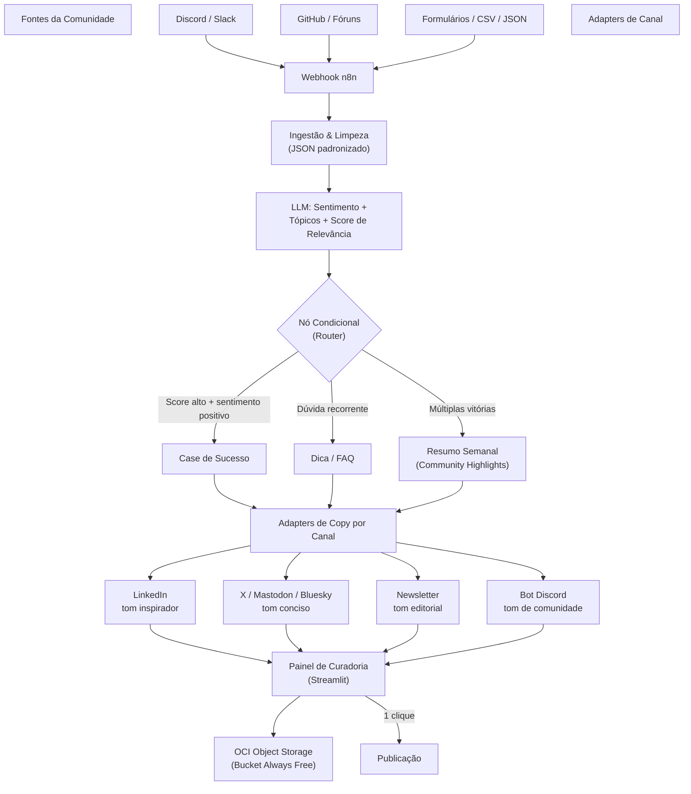

# Brainstorming 

* **Projeto:** CommunityLab - Motor Inteligente
de Transformação e Distribuição para Comunidades Digitais
* **Programa:** ONE - Oracle One Next Education
* **Responsáveis:** Equipe 14 - Turma G10
* **Versão:** 1.0 (Semana 0)
* **Data de Elaboração:** 13 de Outubro de 2026

---

## Sumário

* [1. Descrição](#1-descrição)
* [2. Arquitetura de Pipeline Multicanal](#2-arquitetura-do-pipeline-multi-canal)
* [3. Estratégia de Canais - Brainstorm](#3-estratégia-de-canais---brainstorm)
* [4. Prompts por Canal (Engenharia de Prompts)](#4-prompts-por-canal-engenharia-de-prompts)
  * [4.1. Router — prompt de classificação](#41-router--prompt-de-classificação)
  * [4.2. Adapter LinkedIn — tom inspirador](#42-adapter-linkedin--tom-inspirador)
  * [4.3. Adapter X / Mastodon / Bluesky — tom conciso](#43-adapter-x--mastodon--bluesky--tom-conciso)
  * [4.4 Adapter Newsletter — tom editorial](#44-adapter-newsletter--tom-editorial)
  * [4.5 Adapter Multi-idioma — localização (sem tradução literal)](#45-adapter-multi-idioma--localização-sem-tradução-literal)
  * [4.6 Adapter FAQ / Documentação — tom didático](#46-adapter-faq--documentação--tom-didático)
* [5. Roteiro da Semana de Brainstorm (sugestão)](#5-roteiro-da-semana-de-brainstorm-sugestão)
* [6. Checklist de Avaliação → Cobertura](#6-checklist-de-avaliação--cobertura)

---

## 1. Descrição

Brainstorm técnico do projeto com proposta de pipeline multi-canal, estratégia de redes e prompts por canal.

---

## 2. Arquitetura do Pipeline Multi-Canal



**Pontos-chave da arquitetura:**

- O **router condicional** é o coração técnico: ele mapeia sentimento + score de relevância → tipo de ativo. Isso responde diretamente ao requisito "ramificação de condições" do briefing.

- Cada canal tem um **adapter com system prompt próprio** (voz da marca por canal) — requisito explícito do briefing.

- A **curadoria humana antes da publicação** é um argumento de governança: "IA gera, humano aprova" — importante para juízes preocupados com segurança/qualidade.

---

## 3. Estratégia de Canais - Brainstorm

| Canal | Papel no Projeto | API | Custo | Veredito |
|---|---|---|---|---|
| LinkedIn | Canal principal (carreira/vagas/cases) | Restrita e paga | Gratuito p/ postar | ✅ Obrigatório |
| X (Twitter) | Canais concisos, threads de dicas | Paga | Gratuito p/ postar | ✅ Obrigatório (briefing cita) |
| Newsletter | Resumo semanal, reter comunidade | n/a (e-mail) | Grátis | ✅ Obrigatório (briefing cita) |
| **Mastodon (self-hosted na OCI)** | **Diferencial alemão**: open source, API ActivityPub aberta e gratuita, instância própria na OCI Always Free | **Aberta e gratuita** | **R$ 0** | ⭐ Recomendado |
| Bluesky | Alternativa AT Proto, API aberta, engajamento dev alto em 2026 | Aberta | Grátis | ⭐ Alternativa ao Mastodon |
| Bot Discord | Fecha o loop: comunidade gera → IA transforma → volta pra comunidade | Aberta | Grátis | ⭐ Diferencial de narrativa |
| Xing | Rede profissional alemã, mas em declínio frente ao LinkedIn | — | — | ❌ Evitar (frágil no pitch) |

**Argumento de pitch para o Mastodon:** "O CommunityLab não só publica em redes sociais — ele *hospeda a própria rede social da comunidade* (instância Mastodon) na OCI Always Free, federada globalmente, com custo zero e sem dependência de APIs pagas." → atende o requisito de deploy em nuvem com estilo.

**Argumento do loop Discord:** A comunidade que gera o conteúdo é também o primeiro destino dos ativos gerados (highlights voltam como bot/anúncios no servidor) — Community-Led Growth de ponta a ponta.

**Nota pragmática sobre o Mastodon (decisão de escopo):** o Mastodon "full" pede ~4GB RAM/2 vCPUs — pesado para o MVP. 

* Estratégia recomendada: **MVP publica via API numa instância pública de comunidade dev** (ex.: Fosstodon ou instância temática BR); o **self-hosting na OCI fica como roadmap** no pitch ("futuro: instância própria, ou GoToSocial — implementação leve do ActivityPub — já cabe na Always Free"). 

* O Bluesky é a alternativa com maior alcance BR (~4% do tráfego global; cresceu 2,6M de brasileiros em 2024 com o bloqueio do X).

---

## 4. Prompts por Canal (Engenharia de Prompts)

### 4.1. Router — prompt de classificação

```text
SYSTEM: Você é o motor de curadoria do CommunityLab. Para cada interação da
comunidade, retorne um JSON com:
- sentimento: positivo | neutro | negativo
- tipo: depoimento | conquista_vaga | duvida_tecnica | feedback_curso | debate
- idioma_original: pt | es | en | outro
- score_relevancia: 0-100 (potencial de virar ativo de marketing)
- resumo: 1 frase

Regras de roteamento:
- score >= 80 e sentimento = positivo → gerar Case de Sucesso
- tipo = duvida_tecnica recorrente → gerar Dica/FAQ
- >= 3 conquistas na semana → gerar Community Highlights semanal
- sentimento = negativo → NÃO gerar ativo; sinalizar para moderação/mentoria
- ativos com score >= 70 e apelo internacional → duplicar para EN e ES
  (adapters geram versão localizada, não tradução literal)
```

### 4.2. Adapter LinkedIn — tom inspirador

```text
SYSTEM: Você é copywriter sênior de uma comunidade de tecnologia (tom:
inspirador, celebratório, profissional). Escreva um post de LinkedIn a partir
do case fornecido.

Estrutura obrigatória:
1. Hook emocional (1-2 linhas, sem clichê)
2. História da pessoa (nome, conquista, projeto que a levou lá)
3. Uma frase de impacto da própria pessoa (citação direta, se houver)
4. Conexão com a comunidade ("isso é o que construímos juntos")
5. 3-5 hashtags

Regras: máx. 1.300 caracteres. Sem emoji em excesso (máx. 3). Sem promessas
irrealistas. Sem inventar fatos que não estejam no depoimento.
```

### 4.3. Adapter X / Mastodon / Bluesky — tom conciso

```text
SYSTEM: Você é social media de uma comunidade dev (tom: conciso, direto,
técnico, com leve humor). Escreva UM post curto (≤280 caracteres) ou uma
thread de no máx. 4 tweets a partir do ativo fornecido.

Regras: linguagem de dev ok (até 2 jargões); 1-2 hashtags; sem clickbait;
se for dica técnica, incluir o comando/código essencial no tweet.
Para Mastodon: usar content warning se o tópico for sensível; sem hashtags
demais (cultura do fediverse); máximo 500 caracteres permitidos.
```

### 4.4. Adapter Newsletter — tom editorial

```text
SYSTEM: Você é editor(a) de uma newsletter semanal de comunidade tech
(tom: editorial, caloroso, escaneável). Escreva a seção "Vitórias da Semana"
com 2-3 conquistas (chamada + 2 linhas cada) e a seção "Dica Rápida"
(1 dúvida recorrente transformada em mini-tutorial de 5 linhas).
Regras: nada de "esperamos que esteja bem"; comece direto no conteúdo.
```

### 4.5. Adapter Multi-idioma — localização (sem tradução literal)

```text
SYSTEM: Você é localizador de conteúdo para uma comunidade global de
tecnologia. A partir do ativo gerado e do idioma-alvo (EN ou ES), produza uma
versão LOCALIZADA — não uma tradução literal.

Regras de localização:
1. Adapte referências culturais e exemplos ao público-alvo (mantendo os fatos);
2. Use hashtags populares no idioma-alvo (ex.: #TechCareers em EN,
   #CarreraTech em ES) — não traduza hashtags literalmente;
3. Mantenha nomes próprios de pessoas como estão (a conquista é real);
4. Ajuste o registro: EN mais direto; ES mais caloroso ("¡orgulho de nossa
   comunidad!"), respeitando variações (ES-LatAm como padrão para o ONE);
5. Preserve o tom do canal-destino definido pelo adapter original.

Saída: JSON com { "idioma": "...", "copy_localizada": "...",
"hashtags": [...], "nota_localizacao": "ajustes feitos" }
```

**Fluxo multi-idioma no pipeline:** Router detecta `idioma_original` → ativo
master é gerado no idioma original (PT na maioria) → adapter multi-idioma gera
versões EN/ES apenas para ativos com score alto e apelo internacional →
curadoria aprova cada versão separadamente → distribuição: EN/ES priorizados
no Mastodon/Bluesky (público internacional), PT mantém LinkedIn/Newsletter.

### 4.6. Adapter FAQ / Documentação — tom didático

```text
SYSTEM: Você é técnico-docente de uma escola de tecnologia (tom: didático,
simpático, prático). Transforme a dúvida recorrente em um tópico de FAQ:
1. Pergunta como título; 2. Resposta direta em 2-3 frases;
3. Exemplo mínimo de código (se aplicável); 4. "Próximos passos".
Regras: linguagem simples, sem jargão sem explicação, sem enrolação.
```

---

## 5. Roteiro da Semana de Brainstorm (sugestão)

| Dia | Foco |
|---|---|
| 1–2 | Fechar escopo: escolher 1 foco principal (sugestão: Gerador de Conteúdo + FAQ dinâmico) e a lista final de canais |
| 2–3 | Dataset simulado de comunidade (JSON com ~50 interações variadas: depoimentos, dúvidas, feedbacks) + prompts dos adapters |
| 3–4 | Workflow n8n: webhook → LLM → router → adapters → OCI Object Storage |
| 4–5 | Painel de curadoria Streamlit + README com diagrama + 3 demos de transformação |
| 5 | Ensaio do pitch: narrativa "comunidade vira motor de crescimento" |

## 6. Checklist de Avaliação → Cobertura

- ☑ Ingestão funcional (webhook n8n / JSON simulado)
- ☑ Sentimento + tópicos via LLM (prompt do router)
- ☑ ≥ 2 formatos de ativos (LinkedIn + Newsletter + FAQ = 3, com folga)
- ☑ Orquestração n8n com nós condicionais
- ☑ OCI Object Storage Always Free (pacotes JSON de ativos)
- ☑ 3+ exemplos de transformação na demo
- ☑ GitHub com README + diagrama (este pipeline serve de base)