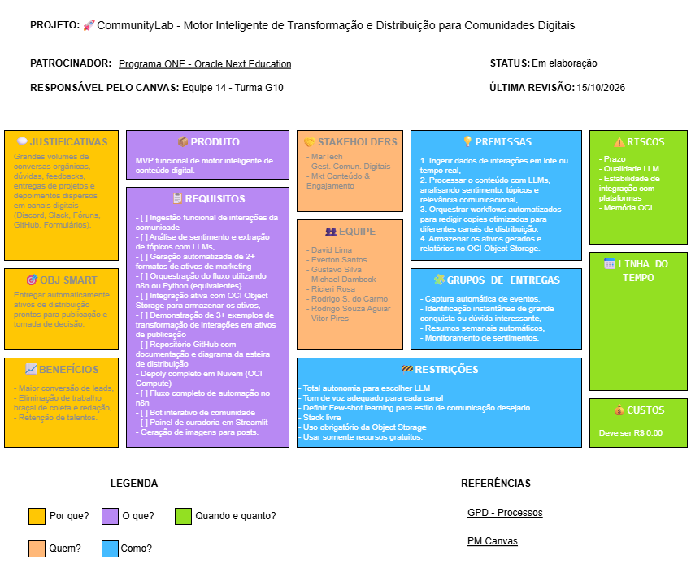

# Escopo do Projeto

* **Projeto:** CommunityLab - Motor Inteligente
de Transformação e Distribuição para Comunidades Digitais
* **Responsáveis:** Equipe 14 - Turma G10
* **Versão:** 2.0 (Semana 1)
* **Data de Elaboração:** 22 de Outubro de 2026

---

## Sumário

- [1. Visão Geral e Justificativa](#1-visão-geral-e-justificativa)
- [2. Objetivos do Projeto](#2-objetivos-do-projeto)
- [3. Fontes de Dados Primárias](#3-fontes-de-dados-primárias)
- [4. Requisitos do Sistema](#4-requisitos-do-sistema)
   - [4.1. Requisitos Funcionais (RF)](#41-requisitos-funcionais-rf)
   - [4.2. Requisitos Não Funcionais (RNF)](#42-requisitos-não-funcionais-rnf)
- [5. Arquitetura do Projeto](#5-arquitetura-do-projeto)
- [6. Limites do Escopo](#6-limites-do-escopo)
   - [6.1. Dentro do Escopo (In Scope))](#61-dentro-do-escopo-in-scope)
   - [6.2. Fora do Escopo (Out of Scope)](#62-fora-do-escopo-out-of-scope)
- [7. Project Model Canvas](#7-project-model-canvas)
- [8. Governança e Gestão](#8-governança-e-gestão)
- [9. Cronograma Geral](#9-cronograma-geral)
- [10. Registro de Alterações](#10-registro-de-alterações)

---

## 1. Visão Geral e Justificativa

O **CommunityLab** é um ecossistema inteligente de automação projetado para transformar o fluxo contínuo de discussões e dúvidas de comunidades técnicas em ativos estruturados de valor educacional e marketing.

A solução foca no **Motor de FAQ Dinâmico e Conteúdo Educativo**, capturando interações reais de fóruns e redes abertas para sintetizar tutoriais curtos, publicações técnicas e bases de conhecimento dinâmicas, operando com **custo zero**.

---

## 2. Objetivos do Projeto

### Objetivo Geral

Desenvolver um MVP funcional capaz de ingerir dados de comunidades, orquestrar triagens com IA, permitir curadoria humana (*Human-in-the-Loop*) e persistir pacotes de conteúdo estruturados na nuvem OCI.

### Objetivos Específicos

* **Ingestão Padronizada:** Receber e normalizar interações em JSON/CSV via endpoints ou webhooks.

* **Tratamento Eficiente:** Higienizar e preparar os dados de entrada com alto desempenho utilizando **DuckDB** e nós de código.

* **Classificação e Roteamento:** Analisar sentimento e categorizar temas usando LLMs com custo zero.

* **Geração Multi-Formato:** Gerar automaticamente pelo menos dois formatos distintos de ativos:
  1. *Posts para LinkedIn / Redes Sociais* (foco técnico/carreira).
  2. *Tópicos de FAQ / Dicas Educativas* (perguntas e respostas sintetizadas).
  3. *Resumos Semanais / Highlights de Comunidade*.
* **Curadoria Humana:** Apresentar os dados em interface interativa (**Streamlit**) para aprovação antes do armazenamento final.
* **Persistência em Nuvem:** Salvar pacotes de distribuição no **OCI Object Storage** (Always Free).

---

## 3. Fontes de Dados Primárias

* **Stack Exchange / Stack Overflow API:** Coleta de dúvidas técnicas, erros frequentes e discussões (foco em IA e programação).

* **Mastodon API:** Monitoramento de instâncias públicas de tecnologia e comunidades abertas via API sem custos.

* **Hacker News (Algolia Search API):** Captura de notícias, discussões da indústria e lançamentos de tendências em tecnologia.

* Como alternativa pode ser utilizado o dataset [LMSYS](https://huggingface.co/datasets/lmsys/lmsys-chat-1m) do Hugging Face, como complemento às demais fontes.

---

## 4. Requisitos do Sistema

### 4.1. Requisitos Funcionais (RF)

| ID | Nome | Descrição |
| :--- | :--- | :--- |
| **RF-01** | **Ingestão de Dados em Lote** | O sistema deve permitir o upload e recebimento de mensagens e discussões técnicas via arquivos JSON/CSV padronizados e Webhook HTTP. |
| **RF-02** | **Validação de Contratos (Schemas)** | O sistema deve validar payloads de entrada e pacotes de saída contra especificações formais de JSON Schema. |
| **RF-03** | **Higienização e Normalização** | O pipeline deve sanitizar strings (remoção de tags HTML, links quebrados e ruídos), remover duplicatas e gerar identificadores únicos (`id`) para cada interação. |
| **RF-04** | **Classificação e Análise com LLM** | O sistema deve submeter as mensagens a modelos de linguagem para categorização temática (ex.: frontend, backend, dados, IA) e avaliação de relevância. |
| **RF-05** | **Geração de Conteúdo Multi-Formato** | O motor de IA deve sintetizar os dados aprovados em pelo menos 3 formatos de saída: post técnico para LinkedIn, tópicos de FAQ (Pergunta e Resposta) e resumos semanais de comunidade. |
| **RF-06** | **Painel de Curadoria (Human-in-the-Loop)** | A interface Streamlit deve listar os conteúdos gerados e permitir ao usuário humano: aprovar, rejeitar ou editar o texto final antes da consolidação. |
| **RF-07** | **Consolidação do Pacote de Distribuição** | O sistema deve compilar apenas os conteúdos aprovados na curadoria em um arquivo estruturado único (`pacote-distribuicao.json`). |
| **RF-08** | **Persistência na Nuvem** | O sistema deve salvar o pacote consolidado em um bucket do serviço OCI Object Storage. |
| **RF-09** | **Exportação e Download Local** | A interface de usuário deve disponibilizar botão de download para o arquivo de saída gerado. |

---

### 4.2. Requisitos Não Funcionais (RNF)

| ID | Categoria | Descrição |
| :--- | :--- | :--- |
| **RNF-01** | **Custo Zero (Cost-Free)** | Toda a solução deve operar estritamente dentro de planos gratuitos: OCI Always Free, instâncias locais gratuitas (Docker/n8n) e free tiers de LLMs (Google Gemini API, Groq ou modelos abertos locais via Ollama). |
| **RNF-02** | **Desempenho no Tratamento Local** | A etapa de higienização, filtragem e normalização estrutural dos dados brutos deve ser executada localmente utilizando DuckDB e scripts Python, minimizando o consumo de memória RAM e processamento computacional. |
| **RNF-03** | **Segurança e Privacidade** | Nenhuma credencial, segredo ou chave de API deve ser versionada no repositório; o carregamento deve ocorrer obrigatoriamente por meio de variáveis de ambiente (`.env`). |
| **RNF-04** | **Resiliência e Fallback de LLM** | O pipeline de IA deve prever tratamento de erros e tolerância a limites de taxa (*rate limits*), suportando transição ou fila de retentativa em caso de indisponibilidade da API principal. |
| **RNF-05** | **Modularidade e Desacoplamento** | O fluxo de orquestração (n8n), a camada analítica de dados (DuckDB), o motor de IA e a interface web (Streamlit) devem comunicar-se por contratos de dados bem definidos (JSON), evitando acoplamento direto. |
| **RNF-06** | **Governança de Código** | Todo código-fonte deve ser versionado no GitHub com proteção estrita de branches: `main` bloqueada para commits diretos, `develop` como branch padrão para integração contínua e exigência de Pull Request com revisão obrigatória para códigos e contratos. |
| **RNF-07** | **Compatibilidade de Ambiente** | A aplicação Python deve ser compatível com a versão 3.11+ e o n8n deve ser instanciável de forma reprodutível via Docker Compose. |

---

## 5. Arquitetura do Projeto

| Camada | Ferramenta / Serviço | Papel no Pipeline |
| :--- | :--- | :--- |
| **Orquestração** | **n8n (Self-Hosted via Docker)** | Gerencia gatilhos de Webhook, nós condicionais e encadeamento de chamadas. |
| **Engenharia de Dados** | **DuckDB + Python** | Limpeza, filtragem por tópicos e normatização estrutural de alto desempenho. |
| **Motor de IA (LLM)** | **Google Gemini API** (Chave gratuita), **Grok** ou **Nvidia API / Ollama*** | Extração de sentimento, categorização e geração de copy dos ativos. |
| **Interface / Curadoria** | **Streamlit** | Painel visual para upload de lotes, visualização e aprovação humana (*Human-in-the-Loop*). |
| **Armazenamento Nuvem** | **OCI Object Storage (Always Free)** | Repositório de documentos JSON consolidados (`pacote-distribuicao.json`). |
| **Infraestrutura (Opcional)** | **OCI Compute (VM Linux Always Free)** | Hospedagem completa do n8n na nuvem para demonstração final. |

---

## 6. Limites do Escopo

### 6.1. Dentro do Escopo (In Scope):
- Ingestão em lote de mensagens no formato JSON/CSV padronizado.
- Normalização de dados e eliminação de caracteres indesejados.
- Geração de 3 tipos de ativos (LinkedIn, Newsletter, FAQ) a partir de um único lote de interações.
- Painel no Streamlit para curadoria manual (aprovar/rejeitar/editar copy).
- Salvamento e leitura dos arquivos JSON no bucket da OCI.
- Versionamento e governança estrita de código com branches protegidas no GitHub (`develop` e `main`).

### 6.2. Fora do Escopo (Out of Scope):
- Publicação automatizada direta via API do LinkedIn ou redes pagas (o sistema entrega a copy pronta para publicação manual).
- Integração com APIs pagas de LLM (OpenAI, Claude comercial) que exijam pagamento.
- Banco de dados relacional complexo de alta concorrência (foco no Object Storage como Data Lake de JSONs).
- Modelagem de IA do zero ou fine-tuning de modelos fundacionais.

---

## 7. Project Model Canvas

---

## 8. Governança e Gestão

* **Duração Total:** 6 Semanas (Semanas 0 a 5).

* **Rituais:**
  * **Sprint Planning:** Semanal às segundas-feiras (obrigatória).
  * **Dailies Assíncronas / Rápidas:** Alinhamento contínuo de impedimentos via Discord (10 min).

* **Regras de Versionamento:**
  * Branch `main` bloqueada para commits diretos.
  * Branch `develop` como padrão para abertura de Pull Requests.
  * Exigência de pelo menos 1 aprovação (code review) para validação de código.
  * Exceção da obrigatoriedade de aprovação para documentações, atas, etc. que não exigem testes de código. Quaisquer adições, ajustes ou revisões de documentação devem ser informados no grupo.

---

## 9. Cronograma Geral

| Etapa | Data/Período | Foco |
|---|---|---|
| Semana 0 | 12/10/2026 a 18/10/2026 | Alinhamento estratégico, documentação inicial e configurações base | 
| Semana 1 | 19/10/2026 a 25/10/2026 | Engenharia de prompts, datasets e ingestão |
| Semana 2 | 26/10/2026 a 01/11/2026 | Orquestração condicional n8n e Módulos da interface | 
| Semana 3 | 02/11/2026 a 08/11/2026 | Geração consolidada, persistência e curadoria |
| Semana 4 | 09/11/2026 a 15/11/2026 | Homologação, OCI Compute e revisão
| Semana 5 | 16/11/2026 a 22/11/2026 | Documentação, preparação da apresentação e revisão final |
| Demo Day 1 | 24/11/2026 | Apresentação
| Demo Day 2 | 26/11/2026 | Apresentação

---

## 10. Registro de Alterações

| Versão | Data de Alteração | Alteração Realizada |
|---|---|---|
| Versão 1.0 | 18/10/26 | Adicionadas as especificações da arquitetura do projeto.|
| Versão 2.0 | 22/10/26 | Adicionada a Hacker News API como fonte de dados, junto ao Stack Overflow/Stack Exchange API e Mastodon API. Reorganização do tópico 7. Project Model Canvas após o tópico 6. Limites do Escopo para manter o mesmo contexto de leitura. |
