# Especificação de Arquitetura do Sistema

- **Projeto:** CommunityLab - Motor Inteligente
de Transformação e Distribuição para Comunidades Digitais
- **Responsáveis:** Equipe 14 - Turma G10
- **Status:** Aprovado / Em Implementação
- **Versão:** 2.0 (Semana 1)
- **Última Atualização:** 23 de Outubro de 2026

---

## Sumário

- [1. Visão Geral e Princípios Arquiteturais](#1-visão-geral-e-princípios-arquiteturais)
- [2. Diagrama de Arquitetura Conceitual](#2-diagrama-de-arquitetura-conceitual)
- [3. Detalhamento dos Componentes](#3-detalhamento-dos-componentes)
- [4. Pipeline de Dados e Fluxo de Execução](#4-pipeline-de-dados-e-fluxo-de-execução)
   - [4.1. Estágio 1: Ingestão Primária e Armazenamento Bruto](#41-estágio-1-ingestão-primária-e-armazenamento-bruto)
   - [4.2. Estágio 2: Engenharia de Dados e Normalização com DuckDB](#42-estágio-2-engenharia-de-dados-e-normalização-com-duckdb)
   - [4.3. Estágio 3: Enriquecimento Cognitivo e Roteamento (LLM Engine)](#43-estágio-3-enriquecimento-cognitivo-e-roteamento-llm-engine)
   - [4.4. Estágio 4: Adapters de Copy por Canal](#44-estágio-4-adapters-de-copy-por-canal)
   - [4.5. Estágio 5: Curadoria Humana (HITL) e Persistência no OCI](#45-estágio-5-curadoria-humana-hitl-e-persistência-no-oci)
- [5. Contratos de Dados e Interfaces](#5-contratos-de-dados-e-interfaces)
- [6. Registro de Alterações](#6-registro-de-alterações)

---

## 1. Visão Geral e Princípios Arquiteturais

O **CommunityLab** é um ecossistema projetado para transformar discussões, dúvidas e conteúdos brutos de comunidades técnicas em ativos estruturados de valor educacional e marketing (tutoriais, FAQs dinâmicos e postagens especializadas).

A arquitetura orienta-se por cinco princípios fundamentais:

1. **Custo Zero Estrito (Cost-Free):** Operação total dentro das cotas Always Free da Oracle Cloud Infrastructure (OCI) e planos gratuitos de APIs (Google Gemini, Groq, Stack Exchange API, Mastodon API e Hacker News API).

2. **Desacoplamento por Contratos (Contract-Driven):** As camadas comunicam-se exclusivamente via esquemas contratuais em JSON Schema (`input_schema.json` e `output_schema.json`), permitindo desenvolvimento e testes independentes.

3. **Eficiência Analítica Local com DuckDB:** Minimização de dependências pesadas de bancos relacionais tradicionais, utilizando DuckDB para processamento analítico vetorial rápido em memória e arquivo local.

4. **Governança com Human-in-the-Loop (HITL):** Nenhum conteúdo gerado por IA é persistido no bucket final sem validação, edição ou aprovação humana prévia na interface visual.

5. **Segurança e Isolamento de Segredos (Zero Leakage):** Isolamento total de credenciais e chaves de API via variáveis de ambiente (`.env`), sem exposição no repositório Git.

---

## 2. Diagrama de Arquitetura Conceitual 

```mermaid
flowchart TD
    %% Estilos Visuais
    classDef source fill:#f8fafc,stroke:#3b82f6,stroke-width:2px,color:#0f172a;
    classDef n8n fill:#fff7ed,stroke:#ea580c,stroke-width:2px,color:#0f172a;
    classDef router fill:#fef3c7,stroke:#d97706,stroke-width:2px,color:#0f172a;
    classDef data fill:#eff6ff,stroke:#2563eb,stroke-width:2px,color:#0f172a;
    classDef channel fill:#f5f3ff,stroke:#7c3aed,stroke-width:2px,color:#0f172a;
    classDef ui fill:#fdf2f8,stroke:#db2777,stroke-width:2px,color:#0f172a;
    classDef oci fill:#f0fdf4,stroke:#16a34a,stroke-width:2px,color:#0f172a;

    %% 1. Fontes de Dados
    subgraph Sources ["1. Fontes da Comunidade"]
        SRC_SO["Stack Overflow / Stack Exchange API"]:::source
        SRC_MST["Mastodon API - Instâncias Tech"]:::source
        SRC_HN["Hacker News API"]:::source
    end

    %% 2. Ingestão Primária
    subgraph Ingestion ["2. Ingestão Primária (n8n Webhook / Coletor)"]
        HOOK["Webhook n8n Receptor<br/><code>/webhook/ingestion</code>"]:::n8n
        RAW_SAVE["Persiste Payload Bruto<br/><code>data/raw/</code>"]:::n8n
    end

    %% 3. Engenharia de Dados Integrada (Pipeline In-Line)
    subgraph DataEngine ["3. Engenharia de Dados (DuckDB e Python 3.11+)"]
        DUCK_CLEAN["DuckDB: Sanitização e Deduplicação<br/>• Remoção de HTML/ruído<br/>• Deduplicação por hash"]:::data
        DUCK_SCHEMA["Validação Contratual<br/><code>input_schema.json</code>"]:::data
        DUCK_AGG["DuckDB: Agrupamento Analítico<br/>• Janelas de tempo (Resumo Semanal)<br/>• Persiste em <code>data/processed/</code>"]:::data
    end

    %% 4. Cognição e Roteamento
    subgraph Cognition ["4. Motor Cognitivo e Roteamento (n8n + LLM)"]
        LLM["LLM Engine (Gemini Flash / Fallback Groq)<br/>• Análise de Sentimento<br/>• Extração de Tópicos<br/>• Score de Relevância"]:::n8n
        ROUTER{"Nó Condicional<br/>(Router)"}:::router

        CASE["Case de Sucesso / Destaque"]:::n8n
        FAQ["Dica Técnica / FAQ"]:::n8n
        WEEKLY["Resumo Semanal<br/>(Community Highlights)"]:::n8n
    end

    %% 5. Adapters
    subgraph Channels ["5. Adapters de Copy por Canal"]
        ADAPT["Adapters de Formatação de Copy"]:::channel
        CH_LI["LinkedIn Post<br/>tom inspirador e técnico"]:::channel
        CH_FAST["Microblogging (Mastodon)<br/>tom conciso e direto"]:::channel
        CH_NEWS["Digest / Artigo<br/>tom editorial e síntese"]:::channel
    end

    %% 6. Curadoria HITL
    subgraph HITL ["6. Curadoria Humana (Streamlit HITL)"]
        CURADORIA["Painel de Curadoria (Streamlit)<br/>• Leitura do lote processado<br/>• Revisão e edição de copy<br/>• Aprovação / Descarte"]:::ui
        EXPORT_PKG["Validação Contratual de Saída<br/><code>output_schema.json</code>"]:::ui
    end

    %% 7. Persistência
    subgraph CloudStorage ["7. Nuvem OCI Always Free"]
        OCI_BUCKET["OCI Object Storage - Bucket<br/><code>pacote-distribuicao-timestamp.json</code>"]:::oci
        PUBLICAR["Disponível para Publicação / Disparo"]:::oci
    end

    %% Conexões Lineares Integradas
    SRC_SO -->|"REST API"| HOOK
    SRC_MST -->|"REST API"| HOOK
    SRC_HN -->|"REST API"| HOOK

    HOOK --> RAW_SAVE
    RAW_SAVE --> DUCK_CLEAN
    DUCK_CLEAN --> DUCK_SCHEMA
    DUCK_SCHEMA --> DUCK_AGG

    DUCK_AGG -->|"Dados higienizados e agregados"| LLM
    LLM --> ROUTER

    ROUTER -->|"Score alto + sentimento positivo"| CASE
    ROUTER -->|"Dúvida recorrente / resolvido"| FAQ
    ROUTER -->|"Janela semanal agregada (DuckDB)"| WEEKLY

    CASE --> ADAPT
    FAQ --> ADAPT
    WEEKLY --> ADAPT

    ADAPT --> CH_LI
    ADAPT --> CH_FAST
    ADAPT --> CH_NEWS

    CH_LI --> CURADORIA
    CH_FAST --> CURADORIA
    CH_NEWS --> CURADORIA

    CURADORIA --> EXPORT_PKG
    EXPORT_PKG -->|"Upload OCI SDK (Always Free)"| OCI_BUCKET
    CURADORIA -->|"Exportação / 1-clique"| PUBLICAR

```



---

## 3. Detalhamento dos Componentes

| Camada | Tecnologia / Ferramenta | Responsabilidade Técnica | Justificativa Arquitetural |
| --- | --- | --- | --- |
| **Ingestão Externa** | Python Scripts / APIs REST | Coleta programática de tópicos, perguntas e discussões das APIs do Stack Exchange e instâncias do Mastodon. | Fontes ricas em dúvidas técnicas reais com cotas de acesso gratuitas disponíveis. |
| **Orquestração** | **n8n v1** (Docker Compose) | Recepção de webhooks, roteamento condicional de mensagens e chamadas encadeadas aos serviços de IA. | Low-code extensível, flexível, self-hosted e sem custo de licença. |
| **Engenharia de Dados** | **DuckDB** + Python 3.11 | Tratamento colunar, deduplicação, normalização estrutural e filtragem rápida sem subir instâncias pesadas de banco. | Desempenho analítico superior minimizando o consumo de memória RAM e processamento computacional. |
| **Motor de LLM** | **Google Gemini API** (Fallback: Groq) | Análise de sentimento, categorização de tópicos e geração de ativos (LinkedIn, FAQ e Resumos). | Camada gratuita estável com suporte a modelos rápidos (Flash). |
| **Curadoria (HITL)** | **Streamlit** | Interface gráfica modular para visualização dos ativos gerados, edição de copy, aprovação/rejeição e disparo de gravação. | Desenvolvimento ágil em Python puro, interativo e desacoplado. |
| **Persistência Nuvem** | **OCI Object Storage** | Armazenamento final dos pacotes consolidados em formato JSON (`pacote-distribuicao-{timestamp}.json`). | Serviço com 10 GB gratuitos disponíveis na cota Always Free. |

---

## 4. Pipeline de Dados e Fluxo de Execução

O fluxo operacional de dados divide-se em 5 estágios:

```text
[Fontes] ──▶ [1. Ingestão / n8n] ──▶ [2. DuckDB Engine] ──▶ [3. LLM + Router] ──▶ [4. Adapters] ──▶ [5. Curadoria HITL / OCI]

```

### 4.1. Estágio 1: Ingestão Primária e Armazenamento Bruto

1. Os coletores programáticos consultam as APIs do Stack Exchange e do Mastodon.

2. Os dados brutos coletados são persistidos em `data/raw/` como payloads JSON e disponibilizados para o pipeline via endpoint do webhook do n8n (`/webhook/ingestion`).

### 4.2. Estágio 2: Engenharia de Dados e Normalização com DuckDB

1. O DuckDB carrega os registros brutos em memória.

2. Executa operações vetoriais de:
    * Remoção de tags HTML, emojis corrompidos e caracteres de controle.
    * Deduplicação baseada no hash do conteúdo da mensagem.
    * Validação da estrutura de entrada conforme o `input_schema.json`.
    * Agrupamento analítico temporal (necessário para consolidar o Resumo Semanal).

3. O lote higienizado é persistido em `data/processed/`.

### 4.3. Estágio 3: Enriquecimento Cognitivo e Roteamento (LLM Engine)

1. O lote higienizado alimenta os prompts estruturados no motor de LLM (Google Gemini Flash, com fallback para Groq).

2. O modelo extrai sentimentos, tópicos e calcula um score de relevância.

3. O **Router Condicional** direciona cada item para sua respectiva categoria:
    * **Case de Sucesso / Destaque:** Itens com score alto e sentimento positivo.
    * **Dica Técnica / FAQ:** Dúvidas técnicas recorrentes com soluções validadas.
    * **Resumo Semanal (Community Highlights):** Interações agregadas da semana.

### 4.4. Estágio 4: Adapters de Copy por Canal

1. Os textos brutos gerados pela LLM passam por módulos de adaptação de tom e formato:
    * **LinkedIn:** Tom inspirador e focado em autoridade técnica.
    * **Microblogging (Mastodon):** Tom conciso, direto e com hashtags relevantes.
    * **Newsletter / Digest:** Tom editorial aprofundado e curadoria de links.

### 4.5. Estágio 5: Curadoria Humana (HITL) e Persistência no OCI

1. A interface Streamlit faz a leitura dos rascunhos adaptados.

2. O curador humano revisa cada ativo no painel:
    * **Aprova:** Aceita o rascunho original.
    * **Edita:** Altera o texto diretamente no painel.
    * **Rejeita:** Descarta o item do lote.

3. Os itens validados são empacotados e validados contra o `output_schema.json`.

4. O pacote consolidado final é enviado via OCI Python SDK para o bucket no **OCI Object Storage**.

---

## 5. Contratos de Dados e Interfaces

Para garantir o desacoplamento e a governança entre as etapas do pipeline, os formatos de dados são estritamente regidos por esquemas JSON Schema:

* **Contrato de Entrada (`data/schemas/input_schema.json`):** Padroniza a estrutura das interações brutas provenientes das fontes externas antes do processamento analítico.

* **Contrato de Saída (`data/schemas/output_schema.json`):** Define a estrutura do pacote final de distribuição consolidado pela curadoria humana e persistido no OCI Object Storage.

---

## 6. Registro de Alterações

| Versão | Data de Alteração | Alteração Realizada |
|---|---|---|
| Versão 1.0 | 18/10/26 | Adicionadas as especificações da arquitetura do projeto.|
| Versão 2.0 | 23/10/26 | Adicionada a Hacker News API como fonte de dados, junto ao Stack Overflow/Stack Exchange API e Mastodon API. |