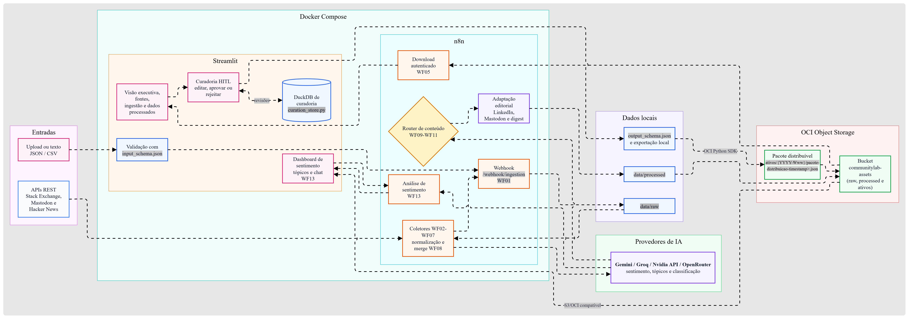

# Especificação de Arquitetura do Sistema

- **Projeto:** CommunityLab - Motor Inteligente
de Transformação e Distribuição para Comunidades Digitais
- **Responsáveis:** Equipe 14 - Turma G10
- **Status:** Aprovado / Em Implementação
- **Versão:** 3.0
- **Data de Elaboração:** 18 de Outubro de 2026
- **Última Atualização:** 21 de Novembro de 2026


---

## Sumário

- [1. Visão Geral e Princípios Arquiteturais](#1-visão-geral-e-princípios-arquiteturais)
- [2. Diagrama de Arquitetura Conceitual](#2-diagrama-de-arquitetura-conceitual)
- [3. Detalhamento dos Componentes](#3-detalhamento-dos-componentes)
- [4. Pipeline de Dados e Fluxo de Execução](#4-pipeline-de-dados-e-fluxo-de-execução)
   - [4.1. Estágio 1: Ingestão Primária e Armazenamento Bruto](#41-estágio-1-ingestão-primária-e-armazenamento-bruto)
   - [4.2. Estágio 2: Engenharia de Dados e Normalização com DuckDB](#42-estágio-2-engenharia-de-dados-e-normalização-com-duckdb)
   - [4.3. Estágio 3: Enriquecimento Cognitivo e Roteamento (LLM Engine)](#43-estágio-3-enriquecimento-cognitivo-e-roteamento-llm-engine)
   - [4.4. Estágio 4: Adapters de Copy por Canal](#44-estágio-4-adapters-de-copy-por-canal)
   - [4.5. Estágio 5: Curadoria Humana (HITL) e Persistência no OCI](#45-estágio-5-curadoria-humana-hitl-e-persistência-no-oci)
- [5. Contratos de Dados e Interfaces](#5-contratos-de-dados-e-interfaces)
- [6. Registro de Alterações](#6-registro-de-alterações)

---

## 1. Visão Geral e Princípios Arquiteturais

O **CommunityLab** é um ecossistema projetado para transformar discussões, dúvidas e conteúdos brutos de comunidades técnicas em ativos estruturados de valor educacional e marketing (tutoriais, FAQs dinâmicos e postagens especializadas).

A arquitetura orienta-se por cinco princípios fundamentais:

1. **Custo Zero Estrito (Cost-Free):** Operação total dentro das cotas Always Free da Oracle Cloud Infrastructure (OCI) e planos gratuitos de APIs (Google Gemini, Groq, Stack Exchange API, Mastodon API e Hacker News API).

2. **Desacoplamento por Contratos (Contract-Driven):** As camadas comunicam-se exclusivamente via esquemas contratuais em JSON Schema (`input_schema.json` e `output_schema.json`), permitindo desenvolvimento e testes independentes.

3. **Eficiência Analítica Local com DuckDB:** Minimização de dependências pesadas de bancos relacionais tradicionais, utilizando DuckDB para processamento analítico vetorial rápido em memória e arquivo local.

4. **Governança com Human-in-the-Loop (HITL):** Nenhum conteúdo gerado por IA é persistido no bucket final sem validação, edição ou aprovação humana prévia na interface visual.

5. **Segurança e Isolamento de Segredos (Zero Leakage):** Isolamento total de credenciais e chaves de API via variáveis de ambiente (`.env`), sem exposição no repositório Git.

---

## 2. Diagrama de Arquitetura do Pipeline Multicanal

O diagrama abaixo representa a implementação atual da arquitetura do pipeline do projeto.



<p align=center>Fig. 01 - Arquitetura do pipeline multicanal</p>


---

## 3. Detalhamento dos Componentes

| Camada | Tecnologia / Ferramenta | Responsabilidade Técnica | Justificativa Arquitetural |
| --- | --- | --- | --- |
| **Entradas** | APIs REST, JSON e CSV | Coleta dados das APIs de Stack Exchange, Mastodon e Hacker News e aceita conteúdo manual pela interface. | Normaliza múltiplas fontes sem acoplar a interface aos provedores externos. |
| **Orquestração** | **n8n** (Docker Compose) | Executa coletores, merges, triagem, roteamento, adaptação editorial e download do bucket. | Orquestração visual self-hosted, versionada como workflows JSON em `n8n/workflows/`. |
| **Interface e Curadoria** | **Streamlit** + Python 3.11 | Exibe dashboards, processa ingestão, registra revisões HITL e exporta JSON aprovado. | Permite operação interna sem desenvolver uma aplicação web separada. |
| **Engenharia de Dados** | **DuckDB** + JSON Schema | Gera snapshots analíticos, consulta dados processados do OCI e persiste o estado da curadoria. | Processamento local rápido e persistência. |
| **Motor de LLM** | **Google Gemini / Groq / Nvidia API / Open Router** | Extrai sentimento, tópicos, relevância e sugere a classificação editorial. | APIs gratuitas ou de baixo custo podem ser escolhidas sem alterar o contrato do projeto. |
| **Persistência** | **OCI Object Storage** | Guarda dados brutos, processados e pacotes aprovados em pastas estruturadas. | Mantém os artefatos disponíveis para n8n e Streamlit dentro da cota OCI Always Free. |

---

## 4. Pipeline de Dados e Fluxo de Execução

O fluxo operacional de dados divide-se em 5 estágios:

```text
Entradas
  ├── APIs REST (Stack Exchange, Mastodon e Hacker News)
  └── Upload manual (JSON ou CSV)
           |
           v
n8n - ingestão, higienização, LLM e adaptação por canal
           |
           v
DuckDB - leitura analítica e snapshot processado
           |
           v
Streamlit - dashboard, chat e curadoria humana
           |
           v
Validação pelo output_schema.json
           |
           v
OCI Object Storage - pacote aprovado e distribuível
```

### 4.1. Estágio 1: Ingestão Primária e Armazenamento Bruto

1. Os workflows do n8n consultam Stack Exchange, Mastodon e Hacker News.

2. A ingestão manual pelo Streamlit valida JSON ou CSV com `input_schema.json` e envia cada registro ao webhook `/webhook/ingestion`.

3. O webhook e os coletores persistem os payloads brutos localmente em `data/raw/` ou no bucket OCI, conforme o workflow configurado.

### 4.2. Estágio 2: Engenharia de Dados e Normalização com DuckDB

1. Os workflows do n8n normalizam e agrupam os registros coletados.

2. O Streamlit usa DuckDB para:
    * Ler JSON processados da pasta local `data/processed/` ou diretamente do OCI via compatibilidade S3.
    * Criar uma view analítica unificada dos campos normalizados.
    * Persistir separadamente as revisões humanas em `data/curation.duckdb`.

3. O lote processado é persistido em `data/processed/` e pode ser enviado ao OCI Object Storage.

### 4.3. Estágio 3: Enriquecimento Cognitivo e Roteamento (LLM Engine)

1. O lote higienizado alimenta os prompts estruturados no motor de LLM (Google Gemini Flash, com fallback para Groq).

2. O modelo extrai sentimentos, tópicos e calcula um score de relevância.

3. O **Router Condicional** direciona cada item para sua respectiva categoria:
    * **Case de Sucesso / Destaque:** Itens com score alto e sentimento positivo.
    * **Dica Técnica / FAQ:** Dúvidas técnicas recorrentes com soluções validadas.
    * **Resumo Semanal (Community Highlights):** Interações agregadas da semana.

### 4.4. Estágio 4: Adapters de Copy por Canal

1. Os textos brutos gerados pela LLM passam por módulos de adaptação de tom e formato:
    * **LinkedIn:** Tom inspirador e focado em autoridade técnica.
    * **Microblogging (Mastodon):** Tom conciso, direto e com hashtags relevantes.
    * **Newsletter / Digest:** Tom editorial aprofundado e curadoria de links.

### 4.5. Estágio 5: Curadoria Humana (HITL) e Persistência no OCI

1. A interface Streamlit faz a leitura dos rascunhos adaptados.

2. O curador humano revisa cada ativo no painel:
    * **Aprova:** Aceita o rascunho original.
    * **Edita:** Altera o texto diretamente no painel.
    * **Rejeita:** Descarta o item do lote.

3. Os itens validados são empacotados e validados contra o `output_schema.json`.

4. Os aprovados são exportados localmente. Quando publicados pelo fluxo OCI, são enviados via OCI Python SDK para `ativos/{YYYY-Www}/pacote-distribuicao-<timestamp>.json`.

---

## 5. Contratos de Dados e Interfaces

Para garantir o desacoplamento e a governança entre as etapas do pipeline, os formatos de dados são estritamente regidos por esquemas JSON Schema:

* **Contrato de Entrada (`data/schemas/input_schema.json`):** Padroniza a estrutura das interações brutas provenientes das fontes externas antes do processamento analítico.

* **Contrato de Saída (`data/schemas/output_schema.json`):** Define a estrutura do pacote final de distribuição consolidado pela curadoria humana e persistido no OCI Object Storage.

---

## 6. Registro de Alterações

| Versão | Data de Alteração | Alteração Realizada |
|---|---|---|
| Versão 3.0 | 21/11/26 | Consolida o diagrama em uma arquitetura única alinhada ao Docker Compose, aos workflows n8n e aos módulos Streamlit/DuckDB reais. |
| Versão 2.0 | 23/10/26 | Adicionada a Hacker News API como fonte de dados, junto ao Stack Overflow/Stack Exchange API e Mastodon API. |
| Versão 1.0 | 18/10/26 | Adicionadas as especificações da arquitetura do projeto.|
